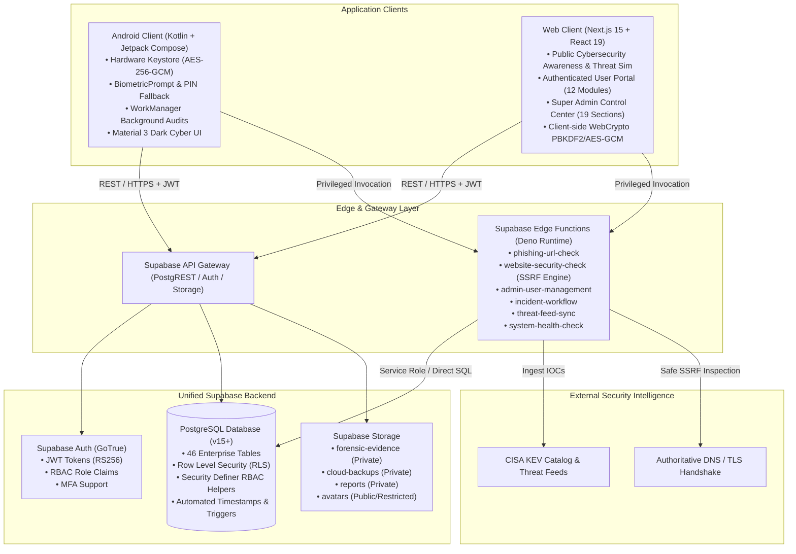

# SIS CYBER FORTRESS — System Architecture

**Document Version:** 1.0.0  
**Target Environment:** Enterprise Cybersecurity Ecosystem  
**Author:** SIS Cyber Fortress Engineering  
**Classification:** Technical Documentation / Public Architecture  

---

## 1. Executive Architecture Summary

**SIS CYBER FORTRESS** is an integrated, 12-in-1 enterprise cybersecurity ecosystem built upon a unified Supabase backend. The platform provides two distinct, fully synchronized application clients:

1. **Android Mobile Application**: Native Kotlin + Jetpack Compose application designed for Android 8.0+ (API level 26 to 34), leveraging hardware-backed Android Keystore cryptography, BiometricPrompt authentication, and background WorkManager telemetry.
2. **Web Portal & Super Admin Console**: Responsive Next.js 15 (React 19, TypeScript, Tailwind CSS) web application featuring a public cybersecurity awareness portal, a tenant security workspace, and an enterprise Super Admin Control Center spanning 19 mission-critical operational sections.

Both clients authenticate against the **same Supabase Auth authority**, read and write to the **same 46-table PostgreSQL schema**, respect identical **Row Level Security (RLS)** boundaries, utilize the same **Supabase Storage buckets**, and invoke the same privileged **Supabase Edge Functions**.

---

## 2. High-Level Component Architecture



---

## 3. Core Architectural Principles & Security Boundaries

### 3.1 Unified Backend Principle
Neither the Android app nor the Web portal maintains its own independent backend or divergent data stores. Every record—from registered devices to phishing scans, ransomware file integrity baselines, and audit logs—resides in a single PostgreSQL database instance.

### 3.2 Zero-Knowledge Vault Isolation
In compliance with enterprise zero-trust mandates:
- **Client-Side Encryption Only**: User vault items (passwords, secure notes, recovery keys) are encrypted on the client using **AES-256-GCM** before transmission.
- **Key Derivation**: On Web, keys are derived via `PBKDF2` (SHA-256, 100,000 iterations) with a cryptographically random 16-byte salt; on Android, keys are created in the hardware-backed `AndroidKeyStore`.
- **Absolute Super Admin Isolation**: Row Level Security explicitly restricts vault access to `auth.uid() = user_id`. Even with administrative database credentials, ciphertexts cannot be decrypted without the user's master key, which is never stored on backend servers or logged.

### 3.3 Server-Side Request Forgery (SSRF) Defense Engine
The WebShield scanner (`website-security-check` Edge Function) performs deep inspections of external web applications while preventing attackers from weaponizing the scanner against internal cloud infrastructure:
1. **URL Normalization**: Rejects invalid schemes, non-standard user-info prefixes, and malformed hostnames.
2. **DNS Pre-Flight Resolution**: Resolves target hostnames to IP addresses before initiating TCP connections.
3. **Blacklist Enforcement**: Immediately terminates if any resolved IP belongs to:
   - Loopback: `127.0.0.0/8`, `::1`
   - RFC 1918 Private Subnets: `10.0.0.0/8`, `172.16.0.0/12`, `192.168.0.0/16`
   - Cloud Provider Metadata Endpoints: `169.254.169.254`, `metadata.google.internal`
   - Link-Local & Carrier-Grade NAT: `169.254.0.0/16`, `100.64.0.0/10`
   - Multicast & Broadcast: `224.0.0.0/4`, `255.255.255.255`
4. **Redirect Validation**: Follows redirects with a maximum hop limit of 3, recursively validating each hop's destination against the SSRF filter.

---

## 4. Role-Based Access Control (RBAC) Architecture

The platform implements a centralized, server-enforced RBAC model across 5 distinct tiers:

| Role Name | Scope & Authority | Data Access Boundary |
|:---|:---|:---|
| **Super Admin** | Full ecosystem control: user lifecycle, role assignment, system settings, global incident response, and storage policies. | Full cross-tenant access to system tables. **Zero access** to user vault plaintext. |
| **Security Admin** | SOC operations, incident triage, security alert escalation, threat feed synchronization, and forensic case management. | Global read/write to telemetry, alerts, incidents, and threat intelligence. |
| **Module Admin** | Scoped operational oversight restricted to assigned security modules (e.g., Phishing Shield or Ransomware Defense). | Filtered access limited to designated module records. |
| **Auditor** | Read-only compliance oversight: inspection of audit logs, compliance reports, and historical security findings. | Read-only access across telemetry and logs. Absolutely no mutation or deletion capabilities. |
| **Standard User** | Personal and enterprise endpoint protection, personal vault management, URL scanning, and identity monitoring. | Strictly isolated to own resources (`user_id = auth.uid()`). |

### RBAC Enforcement Mechanics:
1. **Database Level**: Custom PostgreSQL functions (`is_super_admin()`, `has_role()`) marked as `SECURITY DEFINER` evaluate user permissions directly against the `user_roles` table.
2. **Edge Function Level**: Privileged actions verify the caller's JWT claims and perform an explicit database lookup before executing administrative tasks.
3. **Frontend Level**: `AuthContext.tsx` dynamically evaluates role claims to render navigation items and route guards, while unauthorized API calls are hard-blocked by PostgreSQL RLS.

---

## 5. The 12 Enterprise Security Modules

```mermaid
graph LR
    subgraph CoreSecurity["12 Enterprise Modules"]
        M1["01 Identity Guardian"]
        M2["02 Phishing Shield"]
        M3["03 Endpoint Guardian"]
        M4["04 Network Sentinel"]
        M5["05 Vault Guardian"]
        M6["06 Ransomware Defense"]
        M7["07 WebShield Analyzer"]
        M8["08 Digital Forensics"]
        M9["09 Access Control Center"]
        M10["10 Threat Intelligence"]
        M11["11 Security Backup"]
        M12["12 SOC Incident Command"]
    end
```



1. **Identity Guardian (Module 01)**: Digital identity posture, MFA tracking, session oversight, compromised credential alerts, and active session termination.
2. **Phishing Shield (Module 02)**: Real-time URL heuristic analysis, homoglyph detection, brand spoofing recognition, scan history, and community false-positive reporting.
3. **Endpoint Guardian (Module 03)**: Mobile and workstation asset inventory, OS build monitoring, root/jailbreak detection heuristics, and permission risk auditing.
4. **Network Sentinel (Module 04)**: Connection type telemetry, captive portal detection, open Wi-Fi security alerts, and network configuration audit checklists.
5. **Vault Guardian (Module 05)**: Zero-knowledge AES-256-GCM encrypted credential vault with auto-lock timers, search filters, and client-side password generators.
6. **Ransomware Defense (Module 06)**: SHA-256 file integrity baseline management, canary file tripwires, rapid file modification velocity detection, and incident escalation.
7. **WebShield Analyzer (Module 07)**: Enterprise website perimeter scanner with SSRF-safe HTTP header inspection, TLS configuration grading, and security header audit.
8. **Digital Forensics (Module 08)**: Case management, cryptographically signed evidence locker (SHA-256 hash preservation), chain of custody tracking, and timeline logs.
9. **Access Control Center (Module 09)**: Enterprise RBAC management, API key lifecycle management with cryptographic hashing, and IP whitelist policies.
10. **Threat Intelligence (Module 10)**: Real-time Indicator of Compromise (IOC) tracker (IP, domain, hash, URL) integrated with CISA KEV feeds, severity matrix, and reputation scores.
11. **Security Backup (Module 11)**: Encrypted cloud snapshot management, verification checksums, storage utilization metrics, and automated disaster recovery guidelines.
12. **SOC Incident Command (Module 12)**: Enterprise Security Operations Center incident lifecycle management (`new` -> `investigating` -> `resolved` -> `closed`), impact assessment, and automated escalation.

---

## 6. Monorepo Organization

The project is structured as a clean, cohesive monorepo:

```
sis-cyber-fortress/
├── android-app/                   # Native Android (Kotlin + Jetpack Compose)
│   ├── app/src/main/java/         # Application source code
│   │   └── com/sis/cyberfortress/ # Architecture layers (data, security, ui)
│   ├── app/build.gradle.kts       # Android build and dependencies
│   └── build.gradle.kts           # Root Gradle configuration
├── web-app/                       # Web Portal & Admin (Next.js 15 + Tailwind CSS)
│   ├── src/app/                   # App Router pages (portal, admin, marketing)
│   ├── src/components/            # UI components and layouts
│   └── src/lib/                   # Vault crypto & Supabase client bindings
├── supabase/                      # Backend Architecture
│   ├── migrations/                # 5 SQL migrations (46 tables, RBAC, RLS, Seed)
│   └── functions/                 # 6 Deno Edge Functions
├── shared/                        # Shared Enterprise Specifications
│   ├── types/                     # Shared TypeScript data models
│   └── api-contracts/             # OpenAPI 3.0.3 specification
└── docs/                          # Comprehensive System Documentation
    ├── architecture/              # System and module architecture guides
    ├── database/                  # Schema specifications and ER diagrams
    ├── security/                  # Cryptography and security audit checklists
    ├── testing/                   # Automated build and functional test report
    ├── user-guides/               # Deployment, setup, and build manuals
    └── handover/                  # Final delivery manifest & operational runbook
```
