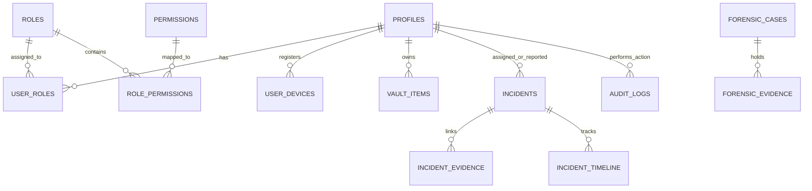

# SIS CYBER FORTRESS — Database Schema & Data Dictionary

**Document Version:** 1.0.0  
**Database Engine:** PostgreSQL 15+ (Supabase)  
**Security Model:** Row Level Security (RLS) Enabled on All Tables  
**Total Tables:** 46 Enterprise Tables  

---

## 1. Database Schema Overview

The SIS CYBER FORTRESS database architecture is designed with relational integrity, auditability, and zero-trust multi-tenancy. Every sensitive table implements Row Level Security (RLS) so that unauthorized access across tenant boundaries is rejected at the database engine level.

### 1.1 Architectural Domains



---

## 2. Table Inventory by Security Domain

| # | Table Name | Domain / Module | Primary Key | Description |
|:---|:---|:---|:---|:---|
| **1** | `roles` | Core RBAC | `id` (UUID) | System security roles (`super_admin`, `security_admin`, etc.) |
| **2** | `permissions` | Core RBAC | `id` (UUID) | Granular permission registry (24 permissions) |
| **3** | `role_permissions`| Core RBAC | `role_id, permission_id` | Join table defining role permission capabilities |
| **4** | `profiles` | Core User | `id` (UUID references `auth.users`) | Extended user profiles, security ratings, MFA flags |
| **5** | `user_roles` | Core RBAC | `id` (UUID) | Active user role assignments |
| **6** | `user_devices` | Module 03 | `id` (UUID) | Registered mobile & workstation assets |
| **7** | `audit_logs` | Core Audit | `id` (UUID) | Immutable operational and administrative activity ledger |
| **8** | `security_alerts` | Core SOC | `id` (UUID) | Centralized threat alert queue from all 12 modules |
| **9** | `security_events` | Core SOC | `id` (UUID) | High-volume security telemetry events |
| **10**| `incidents` | Module 12 | `id` (UUID) | Formal SOC incident management records |
| **11**| `incident_timeline`| Module 12 | `id` (UUID) | Historical timeline of incident actions and notes |
| **12**| `incident_evidence`| Module 12 | `id` (UUID) | Association between incidents and forensic evidence |
| **13**| `threat_tags` | Module 10 | `id` (UUID) | MITRE ATT&CK and threat actor classification tags |
| **14**| `threat_sources` | Module 10 | `id` (UUID) | External feed providers (CISA, URLhaus, AlienVault) |
| **15**| `threat_indicators`| Module 10 | `id` (UUID) | Indicators of Compromise (IP, URL, domain, hash) |
| **16**| `threat_reputation_cache`| Module 10 | `id` (UUID) | Local cache of external threat reputation lookups |
| **17**| `vault_categories` | Module 05 | `id` (UUID) | User-defined vault organizational groupings |
| **18**| `vault_items` | Module 05 | `id` (UUID) | Zero-knowledge AES-256-GCM encrypted credentials |
| **19**| `vault_access_logs` | Module 05 | `id` (UUID) | Client-side decrypted item access audit logs |
| **20**| `phishing_scans` | Module 02 | `id` (UUID) | URL security scan submissions and heuristic scores |
| **21**| `phishing_reports` | Module 02 | `id` (UUID) | User-submitted phishing and scam campaigns |
| **22**| `phishing_allowlist` | Module 02 | `id` (UUID) | Enterprise and tenant approved URL whitelists |
| **23**| `device_telemetry` | Module 03 | `id` (UUID) | OS version, patch level, battery, and root status |
| **24**| `device_app_inventory`| Module 03 | `id` (UUID) | Installed application package names and risk ratings |
| **25**| `device_security_checks`| Module 03 | `id` (UUID) | Compliance audit results for registered endpoints |
| **26**| `network_scans` | Module 04 | `id` (UUID) | Wi-Fi and interface safety evaluations |
| **27**| `network_profiles` | Module 04 | `id` (UUID) | Known networks, captive portal flags, trust ratings |
| **28**| `ransomware_baselines`| Module 06 | `id` (UUID) | Cryptographic SHA-256 file hashes for monitored files |
| **29**| `ransomware_canary_files`| Module 06 | `id` (UUID) | Trap files deployed to detect unauthorized encryption |
| **30**| `ransomware_events` | Module 06 | `id` (UUID) | High-velocity file modification and alert triggers |
| **31**| `web_scans` | Module 07 | `id` (UUID) | SSRF-safe website perimeter security inspections |
| **32**| `web_scan_findings`| Module 07 | `id` (UUID) | Detailed header, TLS, and vulnerability findings |
| **33**| `web_monitored_domains`| Module 07 | `id` (UUID) | Domains scheduled for continuous perimeter audits |
| **34**| `forensic_cases` | Module 08 | `id` (UUID) | Formal investigative cases for security incidents |
| **35**| `forensic_evidence` | Module 08 | `id` (UUID) | Immutable evidence items with SHA-256 signatures |
| **36**| `forensic_custody_logs`| Module 08 | `id` (UUID) | Chain-of-custody transfer records |
| **37**| `api_keys` | Module 09 | `id` (UUID) | Hashed API access keys with granular scopes |
| **38**| `ip_access_rules` | Module 09 | `id` (UUID) | Tenant and administrative IP allow/deny policies |
| **39**| `user_sessions` | Module 01 | `id` (UUID) | Active user sessions and geolocation records |
| **40**| `identity_alerts` | Module 01 | `id` (UUID) | Suspicious login alerts and credential leak warnings |
| **41**| `backup_jobs` | Module 11 | `id` (UUID) | Scheduled backup policies and retention configurations |
| **42**| `backup_snapshots`| Module 11 | `id` (UUID) | Encrypted storage snapshots and verification hashes |
| **43**| `system_settings` | Core Admin | `id` (UUID) | Global platform configurations and feature toggles |
| **44**| `compliance_reports`| Core Admin | `id` (UUID) | Generated executive and auditor security reports |
| **45**| `notification_queue`| Core Alerts | `id` (UUID) | In-app and push notification delivery records |
| **46**| `threat_actor_profiles`| Module 10 | `id` (UUID) | Known APT groups, tactics, and adversary profiles |

---

## 3. Core Security Functions (PostgreSQL)

To maintain absolute separation of privilege without client-side spoofing, authorization helpers are declared as `SECURITY DEFINER`:

### 3.1 `has_role(user_uuid UUID, role_slug TEXT) -> BOOLEAN`
Inspects `user_roles` joined against `roles` for the specified user and role slug.

### 3.2 `is_super_admin(user_uuid UUID) -> BOOLEAN`
Shortcut evaluator returning `TRUE` if the user possesses the `super_admin` role.

### 3.3 `is_security_admin(user_uuid UUID) -> BOOLEAN`
Shortcut evaluator returning `TRUE` if the user possesses either `super_admin` or `security_admin`.

### 3.4 `is_admin_or_auditor(user_uuid UUID) -> BOOLEAN`
Evaluates whether the caller possesses elevated compliance view rights (`super_admin`, `security_admin`, `auditor`, or `module_admin`).

### 3.5 `initialize_super_admin(target_user_id UUID) -> VOID`
Automated setup function that safely elevates the initial registered user to `super_admin` and assigns all 24 security permissions without exposing default administrator passwords.

---

## 4. Row Level Security (RLS) Policies Architecture

Every table is protected by fine-grained RLS rules:

1. **User Isolation Pattern**:
   ```sql
   CREATE POLICY "Users can only view their own records"
     ON user_devices FOR SELECT
     USING (user_id = auth.uid() OR is_admin_or_auditor(auth.uid()));
   ```

2. **Zero-Knowledge Vault Pattern**:
   ```sql
   CREATE POLICY "Users have exclusive access to their vault items"
     ON vault_items FOR ALL
     USING (user_id = auth.uid())
     WITH CHECK (user_id = auth.uid());
   ```
   *Note: Super Admins explicitly do NOT have bypass privileges on `vault_items`.*

3. **Audit Immutability Pattern**:
   ```sql
   CREATE POLICY "Audit logs are append-only"
     ON audit_logs FOR INSERT
     WITH CHECK (true);

   CREATE POLICY "Audit logs cannot be updated or deleted"
     ON audit_logs FOR UPDATE
     USING (false);
   ```

---

## 5. Storage Buckets & Policies

Four dedicated private storage buckets are provisioned:

1. **`forensic-evidence`**: Evidence artifacts stored with read/write access restricted to Security Admins and Super Admins.
2. **`cloud-backups`**: Encrypted system and user snapshots with strict tenant isolation.
3. **`reports`**: Security audit reports and compliance exports.
4. **`avatars`**: Profile imagery with user-level write access.
